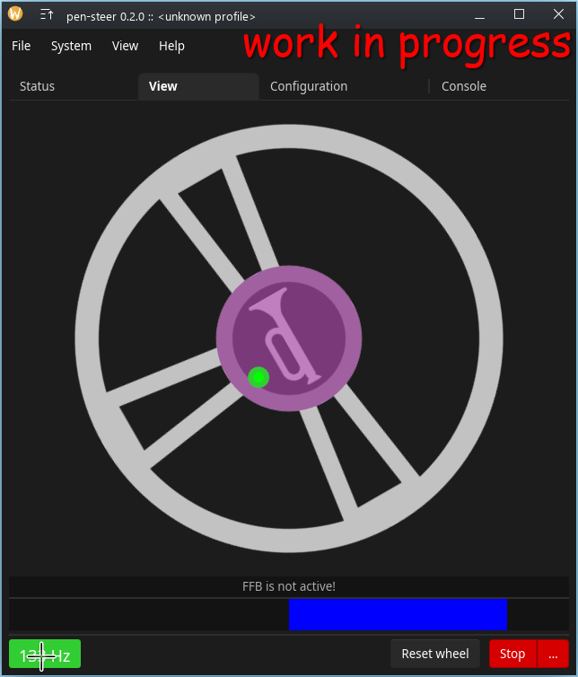

pen-steer
=========

Use a drawing tablet, or something similar, as a steering wheel.

Available for Linux and Windows.

---------

## Why?
Mouse steering is alright ([Euro Truck Simulator 2](https://eurotrucksimulator2.com/), etc.), but I wanted to see if it would be
practical to use a drawing tablet. Surprisingly, it's not that bad; it does take a bit of practice to draw a circle at the centre.
I would still use an actual wheel if I could afford one, though.

As far as I know, there isn't anything else like this (or I didn't search enough), so I made this.
Though, I am probably not the first person to try something like this.

This Rust application is not my first attempt, I wrote the initial prototype in C and a cursed bunch of `ioctl()`s.

## BLAH

under construction!!!

## Licence

The code is licenced under GPL-3.0-or-later.

Most assets are CC-BY-SA-4.0, with some exceptions.

Please see `LICENCES/`, [REUSE.toml](REUSE.toml), and [assets/REUSE.toml](assets/REUSE.toml) for more information.

## Acknowledgements

- The [Roboto Mono](https://github.com/googlefonts/robotomono) font.
